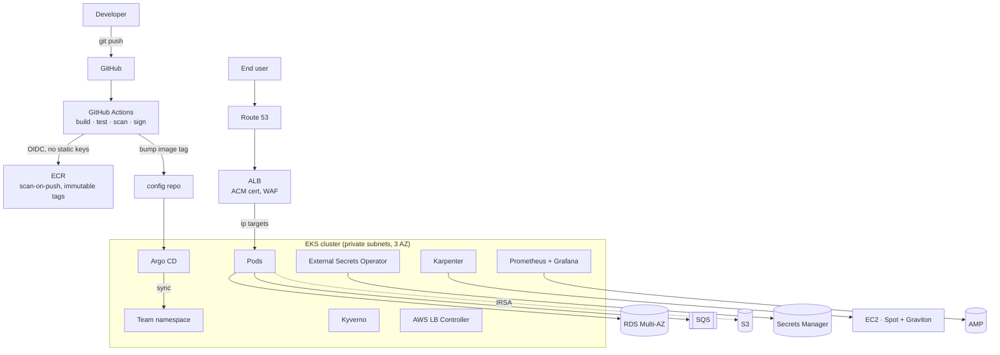
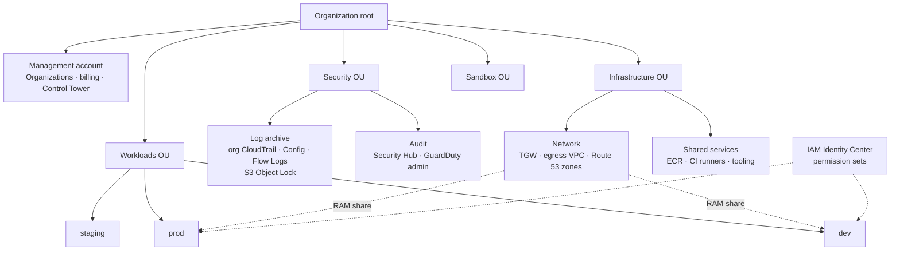
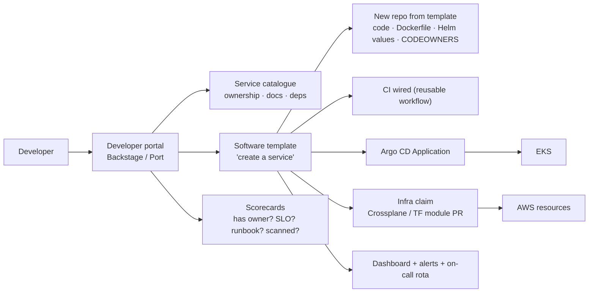
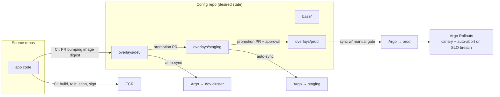
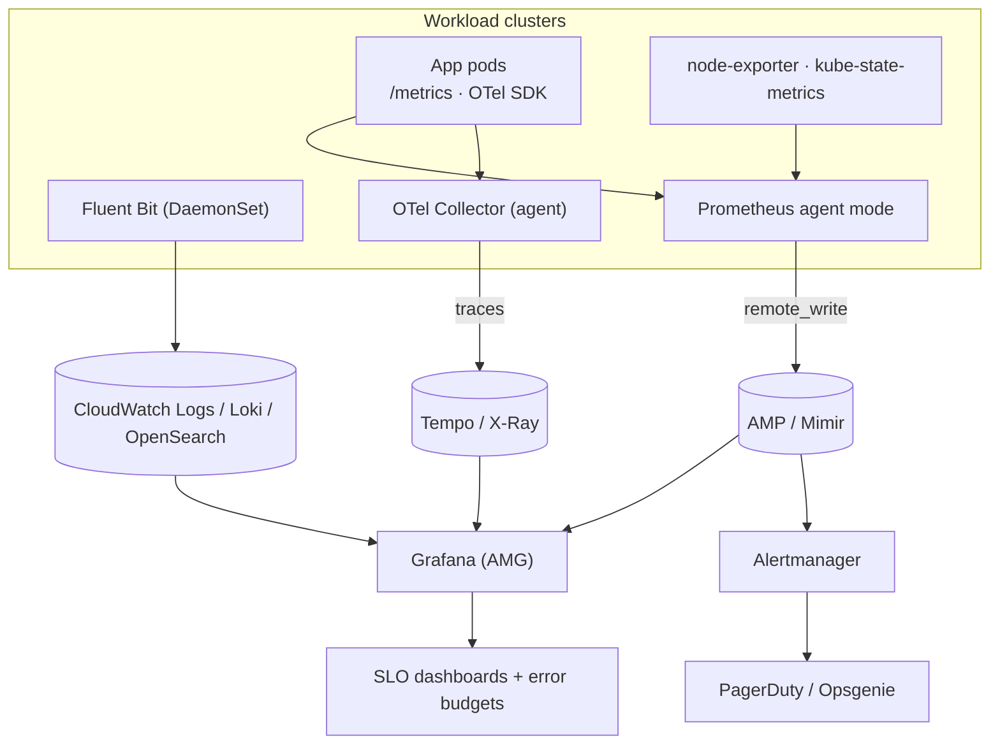
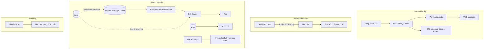
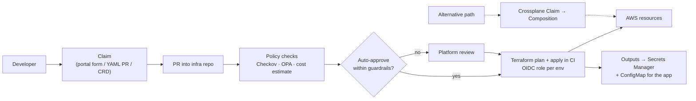
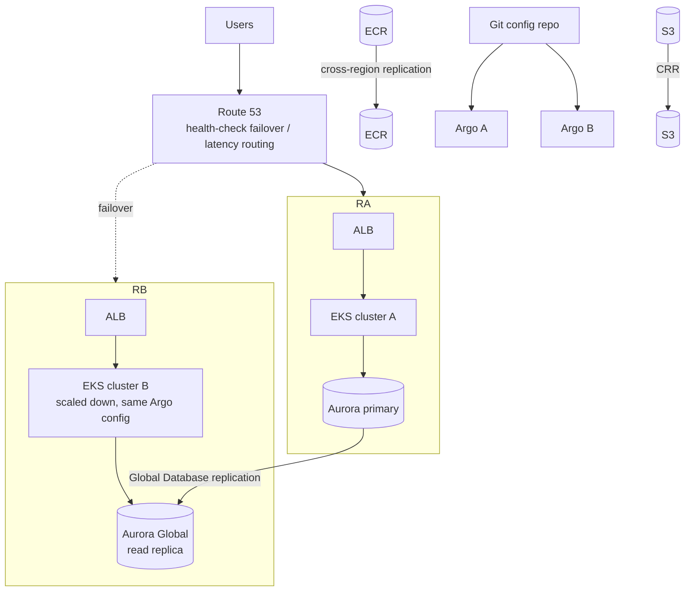

# 04 — Reference architectures

Covers your **Part E**. Eight architectures, each with the same structure so you can rehearse
them consistently. `[INFERENCE]` throughout for design choices; `[OFFICIAL]` where anchored to
AWS/CNCF guidance.

**How to use these:** do not memorise the diagrams. Practise *drawing each one in 5 minutes
while narrating the failure modes*. In a design round, the diagram is the cheap part — the
trade-offs and failure modes are what's being graded.

**Universal answer template for any platform design question:**
1. Clarify users, scale, constraints, and what "done" means
2. Draw the happy path
3. Separate **control plane** (how config changes) from **data plane** (how user traffic flows)
4. Identity and secrets flow
5. Failure modes — and what degrades vs what breaks
6. Observability: what would tell you it's broken before a user does
7. Cost drivers
8. Trade-offs you consciously accepted, and what you'd do differently at 10× scale

---

## 1. AWS EKS application platform

**Problem.** ~15 product teams, ~80 services, each currently inventing its own deploy. Onboarding
a new service takes weeks. No consistent security or observability posture.

**Users.** Product engineers (primary), security (compliance evidence), finance (cost attribution).

| | |
|---|---|
| **Control plane** | Git → Actions → ECR → config repo → Argo CD → K8s API. Terraform owns the cluster + AWS resources. |
| **Data plane** | Route 53 → ALB → pod → datastores. Never touches Argo or CI. |
| **AWS** | EKS, EC2, ECR, ALB, Route 53, ACM, IAM+OIDC, Secrets Manager, KMS, RDS, SQS, S3, CloudWatch, AMP/AMG |
| **OSS** | Argo CD, Karpenter, AWS LB Controller, External Secrets, Kyverno, Prometheus, Grafana, Helm |
| **Security boundaries** | Namespace per team + RBAC + quotas · NetworkPolicy default-deny · PSA `restricted` · IRSA per workload (no shared node role) · Kyverno blocks `:latest`, non-ECR images, privileged pods · nodes in private subnets only |
| **Identity flow** | Human → IAM Identity Center → EKS access entry → RBAC. Workload → SA → IRSA → AWS. CI → GitHub OIDC → IAM role (push to ECR only; **CI never gets cluster credentials**). |
| **Secrets flow** | Secrets Manager → ESO (its own IRSA role, scoped by path) → K8s Secret → env/volume. Nothing secret in Git. |
| **Observability** | Prometheus scrapes via ServiceMonitor → AMP; Grafana dashboards as code; Fluent Bit → CloudWatch Logs; control-plane audit logs on; alerts on SLO burn rate, not CPU. |

**Failure modes**

| Failure | Blast radius | Mitigation |
|---|---|---|
| Argo CD down | **No new deploys**; running traffic unaffected | Accept — control plane failure ≠ outage. Break-glass Helm procedure documented. |
| Karpenter down | No new nodes; existing pods fine | Existing capacity absorbs; alert on pending pods |
| One AZ lost | ~⅓ capacity | Topology spread + PDBs + over-provision; RDS Multi-AZ failover |
| VPC subnet IP exhaustion | **Pods stuck Pending, cluster-wide** | Size subnets for pods-not-nodes; prefix delegation; alert on free IPs |
| CoreDNS saturation | Cluster-wide intermittent failures | Autoscale CoreDNS, NodeLocalDNSCache, reduce `ndots` |
| Kyverno webhook unavailable | **Pod creation fails cluster-wide** | `failurePolicy: Ignore` for non-critical rules, HA replicas, namespace exclusions for kube-system |
| Bad image promoted | One service | Argo rollback / Rollouts canary with automated abort |
| Noisy neighbour | Co-tenants on a node | Requests+limits enforced by policy, ResourceQuota, dedicated node pools for known-hungry workloads |

**Scaling.** HPA (pods) → Karpenter (nodes) → subnet IPs → API server/etcd. Know the order and
which one you hit first. Spot needs interruption handling + PDBs.

**Cost.** NAT, cross-AZ, log ingest, over-requested pods. See [03-aws-competency.md](03-aws-competency.md) §7.

**DR.** Cluster is cattle: Terraform + Argo rebuild in ~30–45 min. Real RTO is bounded by RDS
restore and DNS TTL. Velero for PVs and namespace state.

**Ownership.** Platform owns cluster, add-ons, base charts, policies, pipelines. Teams own app
code, their values files, their SLOs.

**Trade-offs accepted.** Shared cluster (cheaper, needs strong tenancy) over cluster-per-team.
Argo over push-CD (loses "one place to look" but gains drift + no cluster creds in CI).
Karpenter over managed node groups (more power, another component to run).

**Likely questions.** "Why not ECS?" · "How do you isolate teams?" · "How does a new service
onboard?" · "What breaks if Argo is down?" · "How would you do a cluster upgrade with zero
5xx?" · "How do you stop a team consuming the whole cluster?"

---

## 2. Multi-account AWS landing zone

**Problem.** Everything is in one account. Blast radius is total, cost is unattributable,
auditors are unhappy, and dev can reach prod.

**Users.** Every engineering team (as account consumers), security, finance, compliance.

| | |
|---|---|
| **Control plane** | Organizations + SCPs + Control Tower Account Factory + Terraform baseline pipeline |
| **Data plane** | Workload VPCs → TGW → egress VPC → internet; and TGW → shared services |
| **Security boundaries** | The **account** is the primary boundary. SCPs per OU. No cross-account trust except explicit roles. Prod has a separate, smaller set of humans. |
| **Identity flow** | IdP → IAM Identity Center → permission set → role in target account. **Zero IAM users.** Break-glass: one credential per account, in a vault, alarmed on use. |
| **Baseline per account** | VPC + routes, CloudTrail→log archive, Config recorder, GuardDuty, budget + alarm, tag policy, standard roles, KMS keys, DNS association |

**Failure modes**

| Failure | Effect | Mitigation |
|---|---|---|
| Over-broad SCP | Cascading `AccessDenied` across an OU, hard to diagnose | Test in a sandbox OU; SCPs in Terraform with PR review; know that SCP denials appear as generic AccessDenied |
| TGW attachment misroute | Cross-env reachability — a **security** failure | Route tables as code, separate TGW route tables per env, no default propagation |
| Central egress VPC saturation | Everything loses internet | Multi-AZ NAT, monitor NAT port allocation errors |
| Log archive misconfigured | **No audit evidence, discovered during an audit** | Object Lock, cross-region copy, alarm on trail stop |
| Account Factory drift | Accounts diverge from baseline | Config conformance packs + drift detection + periodic re-apply |

**Cost.** TGW attachment-hours + per-GB, central NAT, Config recorder volume, GuardDuty per-event,
duplicated infra per account. Trade-off: isolation costs money.

**Trade-offs.** Account-per-environment-per-team (max isolation, max overhead) vs
account-per-environment (usual sweet spot) vs one shared account (don't). Control Tower
(faster, opinionated) vs pure Terraform (flexible, you own everything).

**Likely questions.** "How do you organise OUs and why?" · "SCP vs IAM policy vs boundary?" ·
"How does a new team get an account, end to end?" · "How do you prevent a region being used?"
· "How do you give a developer read-only prod access safely?"

---

## 3. Internal Developer Platform (portal + templates)

**Problem.** Creating a new service requires 11 manual steps across 6 tools and tribal knowledge.
Nobody knows who owns what.

**Users.** Product engineers (self-service), team leads (ownership), security (catalogue as
inventory), platform team (the thing they maintain).

| | |
|---|---|
| **Golden path** | One opinionated route: language template → container → CI → registry → GitOps → namespace → ingress → dashboards → alerts → on-call. Walking it takes **minutes, not weeks**. |
| **Control plane** | Portal → Git (templates raise PRs) → CI/Argo/Crossplane. **Everything the portal does, it does through Git.** That is the design rule: the portal is a *convenience*, never the source of truth. |
| **Identity** | Portal SSO → GitHub team membership → CODEOWNERS → cluster RBAC. Ownership in the catalogue drives on-call routing. |
| **Measurement** | CNCF's Measurement axis: "Ad hoc → Consistent collection → Insights → Quantitative and qualitative" `[OFFICIAL, CNCF Maturity Model, 2025]`. Track: time-to-first-deploy, % services on golden path, scorecard pass rate, lead time, change failure rate. |

**Failure modes**

| Failure | Effect | Mitigation |
|---|---|---|
| **Low adoption** | The #1 real failure. Platform exists, teams route around it | Make the paved road *the fastest path*, not a mandate. Migrate one friendly team, publish the before/after, let pull develop. CNCF: mature adoption is "**Intrinsic pull**" `[OFFICIAL]` |
| Template drift | 40 repos scaffolded from a template that's now wrong | Renovate-style automated PRs to regenerate; version the template; scorecard flags stale |
| Portal becomes source of truth | Portal outage blocks work; state diverges from Git | Portal only raises PRs. Everything reproducible without it. |
| Catalogue rot | Ownership data is stale, so on-call routing is wrong | Catalogue generated from repo metadata, not hand-maintained; scorecard fails on missing owner |
| Golden path too narrow | Teams with legitimate needs are blocked and resent you | Explicit, time-boxed exception process; treat repeated exceptions as roadmap input |

**Cost.** Mostly engineering time — Backstage is a React/Node app *you now operate*. Budget for
that honestly; it is the most common under-estimate in platform engineering `[INFERENCE]`.

**Trade-offs.** Backstage (free, flexible, you maintain a real app) vs Port/Cortex (SaaS, fast,
less control, recurring cost) vs "no portal, just a `cookiecutter` + docs" — which is genuinely
the right answer below ~50 engineers and saying so demonstrates judgement.

**Likely questions.** "How do you get adoption without a mandate?" · "What's in a golden path?"
· "How do you measure developer experience?" · "A team bypasses the platform — what do you do?"
· "What happens to the 40 services created from a template you now need to change?"

---

## 4. GitOps deployment platform

**Problem.** Deploys are `kubectl` from laptops. No audit trail, config drift everywhere,
rollbacks are archaeology.

| | |
|---|---|
| **Control plane** | Git is the source of truth. Argo reconciles continuously (pull). |
| **Key property** | **CI never holds cluster credentials.** CI's only privilege is push-to-ECR and open-a-PR. This is both a security and a blast-radius win — say both. |
| **Promotion** | By pull request between overlays, with the image referenced by **digest**, not tag. Approval is a GitHub environment protection rule; the audit trail is `git log`. |
| **Drift** | `selfHeal: true` reverts manual changes. Deliberately break it in a demo: `kubectl delete deploy` and watch it return. |
| **Secrets** | ESO/SOPS. Never plaintext in Git — the one rule GitOps makes people confront. |
| **Rollback** | `git revert` → Argo syncs. Or Argo Rollouts aborts a canary automatically on an analysis-template failure. |

**Failure modes**

| Failure | Effect | Mitigation |
|---|---|---|
| Argo down | No deploys, no self-heal; traffic fine | HA mode; documented break-glass; alert on repo-server/app-controller health |
| **Permanent `OutOfSync`** | Alert fatigue, then everyone ignores Argo | Cause is almost always a mutating webhook, a defaulted field, or HPA-managed `replicas`. Fix with `ignoreDifferences`, not by disabling sync |
| `prune: true` + bad manifest | **Deletes production resources** | Prune only in non-prod initially; sync windows; `Prune=confirm`; resource-level `Prevent Deletion` annotations |
| Git repo unavailable | Reconciliation stops | Mirror; Argo keeps last-known state; degraded ≠ down |
| Two controllers manage the same object | Fight loop | One owner per resource. Argo `ignoreDifferences` for HPA-managed replicas |
| Non-determinism (`:latest`, `helm --set` of a timestamp) | Endless diffs | Digests + reproducible rendering |

**Trade-offs.** Argo CD (UI, multi-tenancy, RBAC, App-of-Apps) vs Flux (lighter, composable,
Kustomize-native). Mono config repo (easy promotion, coarse permissions) vs repo-per-team
(clean ownership, harder cross-cutting changes). **ApplicationSet** removes the "500 near-identical
Application YAMLs" problem — name it.

**Likely questions.** "Push vs pull CD?" · "Where do secrets live?" · "How do you promote to
prod?" · "Argo says OutOfSync but nothing changed — debug it." · "How do you roll back?" ·
"How do you stop Argo deleting something you need?"

---

## 5. Centralised observability platform

**Problem.** Five teams, five monitoring stacks, no shared incident view, alert fatigue, an
unexplained six-figure log bill.

| | |
|---|---|
| **Standard the platform imposes** | Every service exposes RED metrics on `/metrics`, emits structured JSON logs with a trace ID, and propagates W3C trace context. The platform provides the libraries/sidecars so this is free for teams. |
| **Alerting philosophy** | **Alert on symptoms (SLO burn rate), not causes (CPU).** Multi-window multi-burn-rate: fast window catches a sudden outage, slow window catches a gradual bleed. Every page has a runbook link or it gets deleted. |
| **Tenancy** | Label every series with `team` and `service`; Grafana folders + Alertmanager routing by team label. |

**Failure modes**

| Failure | Effect | Mitigation |
|---|---|---|
| **Cardinality explosion** (user ID / request ID / pod name as a label) | Prometheus OOMs; **you go blind during an incident** | Enforce a label allow-list via relabel rules, alert on series count per job, review new metrics in PR, drop high-cardinality at the agent |
| Monitoring depends on the thing it monitors | You can't see the outage | Run alerting outside the workload cluster; independent external synthetic check |
| Alert fatigue | Real pages get ignored | Delete alerts that never led to action; measure pages-per-shift as a real metric |
| Log ingest cost spike | Budget blown in days | Retention on every group, sampling, drop debug in prod, alert on ingest-rate anomaly |
| Trace sampling too low | Nothing useful during the incident you cared about | Tail sampling: keep all errors and slow traces |

**Cost.** Log ingest ≫ log storage. Custom CloudWatch metrics are per-metric per-month.
Cardinality is a cost driver as much as a stability one. Long trace retention is rarely worth it.

**Trade-offs.** Self-managed Prometheus (cheap, you operate it, breaks at scale) vs AMP/Mimir
(scales, costs) vs Datadog (best UX, largest bill and the hardest to leave — vendor lock-in is
a legitimate answer, and so is "we chose it anyway because the team is small").

**Likely questions.** "Design monitoring for a new service." · "Prometheus is OOMing — why?" ·
"What's an SLI vs SLO vs error budget?" · "Write a burn-rate alert." · "Halve our observability
bill without going blind." · "What do you alert on for a queue worker?"

---

## 6. Secrets and identity platform

**Problem.** Secrets in `.env`, in Jenkins, in Slack, in Git history. Nobody knows what's
rotated. An engineer leaves and there's no revocation story.

**Principles to state out loud**

1. **No long-lived credentials anywhere.** OIDC for CI, IRSA/Pod Identity for workloads,
   SSO for humans. If you find a static key, that's an incident, not a config item.
2. **Secrets have owners, paths, and rotation schedules.** Path convention encodes scope:
   `/<env>/<team>/<service>/<key>` — which lets you write a *precise* IAM policy per workload.
3. **Least privilege is enforced by structure, not discipline.** One role per workload,
   scoped by path prefix, generated by the platform's Terraform module.
4. **K8s Secrets are base64, not encryption.** Therefore: etcd encryption with KMS, tight RBAC
   on `get secrets`, and never `kubectl get secret -o yaml` in a shared terminal.

**Failure modes**

| Failure | Effect | Mitigation |
|---|---|---|
| **Secret printed in CI logs** | Public exposure if the repo/log is public | Mask/`add-mask`, never `set -x` around secrets, scan logs, and **rotate first, investigate second** |
| Rotation breaks running pods | Outage during a security improvement | ESO refresh interval + app reloads on file change, or a rolling restart hook; test rotation in staging |
| ESO's own role too broad | One compromise reads every secret | Scope ESO per namespace with path-prefixed policies, not one cluster-wide reader |
| Cert expiry | Sudden total outage, always at a weekend | Alert at 30/14/7 days; cert-manager auto-renew; monitor from *outside* |
| Departed employee retains access | Audit finding | SSO-only, group-driven; break-glass credential alarmed on use |

**Trade-offs.** Secrets Manager (native, IAM-integrated, per-secret cost) vs Parameter Store
(cheaper, fewer features) vs Vault (dynamic credentials, PKI, cloud-agnostic — and now you
operate Vault, including its unseal story). Sealed Secrets/SOPS (secrets in Git, encrypted) vs
ESO (secrets outside Git) — ESO is the better default; SOPS wins where you need pure GitOps
reproducibility.

**Likely questions.** "How does a pod get AWS credentials?" · "A secret leaked into CI logs —
what now?" · "Vault vs Secrets Manager?" · "How do you rotate a DB password with zero
downtime?" · "How do you stop a developer reading prod secrets?" · "Are K8s Secrets encrypted?"

---

## 7. Self-service infrastructure provisioning

**Problem.** "I need an S3 bucket" is a Jira ticket with a 3-day SLA. The platform team is a
bottleneck and hates it.

| | |
|---|---|
| **The core design decision** | **Constrain the interface, not the person.** A dev asks for "a Postgres for service X, size small, env dev". They do not get raw Terraform. The module decides encryption, backups, subnet group, parameter group, tags. |
| **Guardrails** | Auto-approve when: within an allow-listed resource set, size ≤ threshold, cost delta ≤ threshold, tags present, non-prod. Otherwise human review. |
| **Two implementations** | **(a) Terraform-in-CI** — boring, debuggable, everyone understands it. **(b) Crossplane** — K8s-native, continuous reconciliation, composition, but a new control plane to operate and a harder debugging story. |

**Failure modes**

| Failure | Effect | Mitigation |
|---|---|---|
| State corruption / lock held | All provisioning stops | Remote backend + DynamoDB lock; documented `force-unlock` procedure with a check that the job is truly dead |
| Plan destroys a prod resource | Data loss | `prevent_destroy`, plan diff review in PR, required approval for destructive changes, `moved` blocks on refactor |
| Drift from console changes | Reality ≠ code | Scheduled `plan` with drift alert; deny console write in prod via SCP |
| Runaway self-service | Cost explosion | Quotas per team, budget alarms, TTL on non-prod resources, auto-cleanup of untagged |
| Module upgrade breaks 60 consumers | Fleet-wide breakage | Semver + changelog, canary consumers, `terraform test`, deprecation windows |

**Trade-offs.** Speed vs control: every auto-approval you add removes a bottleneck and adds a
way to be surprised. Start with a narrow allow-list and widen based on evidence. Crossplane is
genuinely elegant and genuinely more to operate — do not adopt it to look modern.

**Likely questions.** "Design self-service databases." · "How do you stop cost running away?"
· "Terraform vs Crossplane?" · "How do you version and roll out a module change to 60 teams?"
· "How do you handle a team that needs something the module can't express?"

---

## 8. Hybrid / multi-region production platform

**Problem.** A regulator or an RTO commitment requires surviving the loss of a full region.

| | |
|---|---|
| **The honest position** | Multi-region is expensive, slows every change, and is usually not justified. **Say this first**, then say what would justify it: a contractual RTO the AZ model can't meet, or a regulatory data-residency requirement. Interviewers reward the pushback. |
| **What makes it work** | Everything stateless is trivially reproducible from Git. **The data layer is the entire difficulty.** Aurora Global gives ~1s RPO with a manual-ish promote; true active-active needs conflict resolution you probably don't want. |
| **Failover runbook** | Promote DB → scale up region B → shift DNS → verify → communicate. Every step scripted, and **practised on a schedule** or it will not work. |

**Failure modes**

| Failure | Effect | Mitigation |
|---|---|---|
| Failover never tested | It fails when needed — the default outcome | Quarterly game day, measured against the stated RTO |
| DNS TTL too high | RTO blown by cache | Low TTL on failover records (and pay the query cost) |
| Split brain | Data corruption | Single writer; promotion is a deliberate, one-way, human-gated action |
| Standby drift | Region B can't actually run the workload | Same Git config, same Argo, run real (low) traffic in B continuously — **a cold standby is a guess** |
| Region-B capacity unavailable at failover | Failover fails when everyone else is failing over too | Capacity reservations, or accept degraded service and say so |

**Cost.** Roughly 1.6–2× for warm standby. Cross-region transfer. Duplicated control planes.
Ongoing engineering drag on every change. That last one is the cost people forget.

**Likely questions.** "Do you actually need multi-region?" · "Active-active vs active-passive?"
· "What's your RTO/RPO and how do you know?" · "Region A is down — walk me through the next 30
minutes." · "How do you keep the standby honest?"

---

## Cross-cutting: the five things every one of these architectures needs

If you forget everything else in this file, remember that a design answer is incomplete without:

1. **Identity** — how does each component prove who it is, without a stored credential?
2. **Blast radius** — what is the isolation unit (account / cluster / namespace / node pool)?
3. **The control-plane/data-plane split** — and the explicit statement that control-plane
   failure should degrade *change*, not *traffic*.
4. **Observability of the platform itself** — who watches the watcher; where does the alert go.
5. **The exit** — rollback, DR, and how you'd decommission this if it were wrong.
