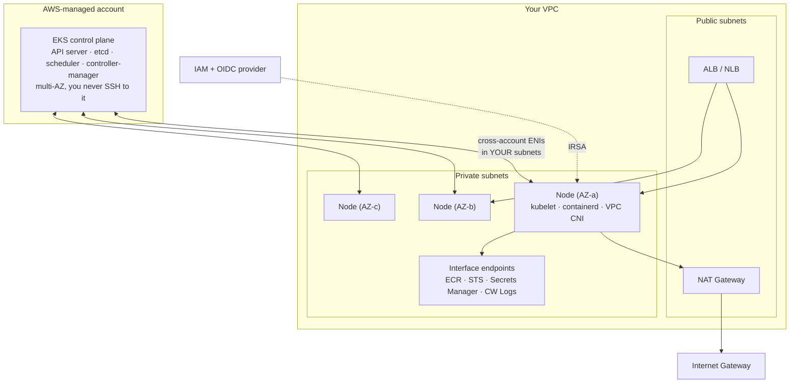

# 03 — AWS competency model for Platform Engineers

Covers your **Part D**. Anchored where possible to `[OFFICIAL]` AWS guidance retrieved
2026-09-10; everything about *hiring* frequency is `[INFERENCE]` and stated as such.

> **The organising insight for your prep:** the AWS EKS Best Practices Guide publishes exactly
> these domains — **Security, Reliability, Cluster Autoscaling (Karpenter / cluster-autoscaler
> / Auto Mode), Networking, Scalability, Cluster Upgrades, Cluster Version Rollback, Cost
> Optimization**, plus Windows / Hybrid / AI-ML `[OFFICIAL,
> docs.aws.amazon.com/eks/latest/best-practices, retrieved 2026-09-10]`. AWS also ships
> `hardeneks`, a CLI that checks a cluster against those recommendations `[OFFICIAL]`.
> Treat that domain list as your EKS interview syllabus, and run `hardeneks` against your own
> project cluster — that is a genuine talking point almost nobody brings.

---

## 1. Master competency matrix

**Market frequency** = `[INFERENCE]` band, basis stated in §2–§8. **Interview depth**:
`Conceptual` / `Working` / `Deep`. **Hands-on** = must you have built it, or can you reason
about it? **Priority** = P0/P1/P2/P3 for you specifically.

| AWS area | Services / concepts | Market frequency | Interview depth | Hands-on requirement | Priority |
|---|---|---|---|---|---|
| **Identity & access** | IAM policies, policy evaluation logic, roles, trust policies, resource policies, permission boundaries, STS, cross-account | Near-universal | **Deep** | **Must have built** | **P0** |
| **Workload identity on EKS** | IRSA (OIDC), **EKS Pod Identity**, node role vs pod role | Very common (EKS roles) | **Deep** | **Must have built** | **P0** |
| **VPC fundamentals** | Subnets, route tables, IGW, NAT GW, SG vs NACL, DNS options | Near-universal | **Deep** | **Must have built** | **P0** |
| **EKS core** | Cluster architecture, managed node groups, add-ons, access entries, control-plane logging | Very common | **Deep** | **Must have built** | **P0** |
| **EKS networking** | VPC CNI, IP-per-pod, ENI limits, IP exhaustion, prefix delegation, CoreDNS, AWS LB Controller, `ip` vs `instance` targets | Very common | **Deep** | **Must have built** | **P0** |
| **EKS scaling** | Karpenter, NodePools/NodeClasses, consolidation, Spot, cluster-autoscaler (legacy), Auto Mode | Very common | **Deep** | **Must have built** | **P1** |
| **EKS upgrades** | Control plane → nodes → add-ons, API deprecations, PDBs, surge, **rollback** | Common; **high senior signal** | **Deep** | **Must have done once** | **P1** |
| **Compute** | EC2 families, ASGs, launch templates, Spot interruption, Graviton, Fargate, Lambda | Very common | Working | Built | **P1** |
| **Secrets & crypto** | Secrets Manager, Parameter Store, KMS (envelope encryption, key policies, grants), ACM | Very common | Working→Deep | Built | **P1** |
| **Observability** | CloudWatch metrics/logs/alarms/dashboards, Container Insights, AMP, AMG, X-Ray, log retention | Very common | Working | Built | **P1** |
| **Storage** | S3 (policies, lifecycle, versioning, replication), EBS gp3/io2, EFS, snapshots | Near-universal | Working→Deep | Built (you have S3) | **P1** |
| **Cost engineering** | Cost Explorer, Budgets, Savings Plans/RIs, Spot, **NAT + cross-AZ + log-ingest as top cost traps**, tagging, rightsizing | Common; **very high senior signal** | **Deep** (reasoning) | Have measured something | **P1** |
| **Load balancing & DNS** | ALB, NLB, target groups, health checks, Route 53 (public/private, failover, health checks) | Very common | **Deep** | Built | **P1** |
| **Reliability & DR** | Multi-AZ vs multi-region, RTO/RPO, AWS Backup, snapshots, S3 replication, Route 53 failover, EKS DR | Common | Working→Deep | Designed + one restore tested | **P1** |
| **Audit & config** | CloudTrail, AWS Config, Security Hub, GuardDuty | Common (regulated/GCC higher) | Working | Enabled once | P2 |
| **Multi-account governance** | Organizations, OUs, **SCPs**, Control Tower, Account Factory, landing zone, RAM, IAM Identity Center | Common; **near-universal in archetype 5** | Working→Deep | Designed; built at small scale | P2 (**P1 if targeting archetype 5**) |
| **Advanced networking** | Transit Gateway, peering, PrivateLink, VPC endpoints, VPN, Direct Connect, Flow Logs | Common | Working | Built endpoints; designed TGW | P2 (you partly have endpoints) |
| **Ops automation** | Systems Manager (Session Manager, Patch, Parameter Store), EventBridge automation, Incident Manager | Role-dependent | Working | Used | P2 |
| **Edge & protection** | CloudFront, WAF, Shield, Global Accelerator | Role-dependent | Conceptual | — | P3 |
| **Data services** | RDS/Aurora, ElastiCache, MSK, OpenSearch, DynamoDB, SQS/SNS/EventBridge | Common | Working (provision + operate) | Provisioned via IaC | P2 (you have several) |
| **Other container platforms** | ECS, Fargate-on-ECS, App Runner, Batch | Role-dependent | Conceptual→Working | — | P3 (know the ECS-vs-EKS trade-off) |

---

## 2. Ranked: what to prepare first

### Rank by **interview probability** `[INFERENCE]`

1. IAM — policy evaluation, roles, cross-account, IRSA
2. VPC — subnets, routing, SG vs NACL, NAT, endpoints
3. EKS — architecture, networking, identity, scaling, upgrades
4. Load balancing + DNS — ALB/NLB, target types, health checks, Route 53
5. Compute — EC2/ASG/Spot/Graviton, Fargate, when Lambda
6. Observability — CloudWatch model, metrics/logs/alarms, retention
7. Cost — NAT, cross-AZ, log ingest, Spot/Savings Plans, tagging
8. Secrets/KMS — Secrets Manager, envelope encryption, rotation
9. Reliability/DR — Multi-AZ vs multi-region, RTO/RPO, backup/restore
10. Multi-account governance — Organizations, SCPs, Control Tower
11. Storage — S3/EBS/EFS specifics
12. Audit — CloudTrail, Config, Security Hub, GuardDuty

### Rank by **day-one job performance** (different order — note it)

1. VPC + IAM debugging (you will do this on day one, guaranteed)
2. EKS operations and add-on lifecycle
3. Terraform against AWS (state, providers, multi-account)
4. Observability wiring and alert triage
5. Cost visibility
6. Secrets and identity plumbing
7. Everything else

**Gap worth noticing:** multi-account governance interviews well above where it sits in daily
work for a mid-level engineer, and DR interviews far above how often you actually do it.
Prepare *narratives* for those two; prepare *muscle memory* for the top four.

---

## 3. IAM — the highest-leverage AWS topic you already partly own

### Policy evaluation logic — memorise this

Effective permission for a request is decided in this order:

1. **Explicit `Deny`** anywhere (identity, resource, SCP, boundary, session) → **DENY**. Always wins.
2. **SCP** must allow (for accounts in an Organization) → else DENY
3. **Resource-based policy** allow → can grant access *even without* an identity policy, for
   *some* services (S3, SQS, KMS, Secrets Manager…) — this is how cross-account works
4. **Permission boundary** must allow (if attached) → else DENY
5. **Session policy** must allow (if present) → else DENY
6. **Identity policy** allow → else implicit DENY

> The question *"the user has `s3:GetObject` Allow but gets AccessDenied — why?"* is testing
> exactly this list. Walk it top to bottom out loud. See
> [06-question-bank.md](06-question-bank.md) §16.

### Policy types — know which is which

| Type | Attached to | Answers |
|---|---|---|
| Identity policy | user/group/role | "What can this principal do?" |
| **Trust policy** | role only | "**Who may assume this role?**" — the one people forget |
| Resource policy | S3 bucket, SQS queue, KMS key… | "Who may touch this resource?" |
| Permission boundary | user/role | "What's the maximum this principal could ever have?" |
| SCP | OU/account | "What's the ceiling for the whole account?" |
| Session policy | passed at `AssumeRole` | "Narrow this session further" |

**KMS gotcha worth knowing:** a KMS key policy is not optional the way most resource policies
are — if the key policy does not delegate to IAM, no identity policy can grant access. This
catches people constantly, including on cross-account S3-SSE-KMS.

### IRSA vs EKS Pod Identity

| | IRSA | EKS Pod Identity |
|---|---|---|
| Mechanism | Cluster OIDC provider registered in IAM; pod gets a projected SA token; SDK calls `sts:AssumeRoleWithWebIdentity` | EKS Pod Identity Agent + an *association* between SA and role |
| Trust policy | References OIDC provider ARN + `sub` condition on `system:serviceaccount:<ns>:<sa>` | Trusts the EKS Pod Identity service principal |
| Cross-cluster reuse | Painful — trust is per-cluster-OIDC | Easier — role is not bound to a specific OIDC issuer |
| Maturity | Older, universal, works everywhere | Newer, simpler operationally |
| Interview value | **Must be able to draw the token flow** | Must know it exists and why it was introduced |

**Draw this from memory:**

```
Pod ──(projected SA JWT, audience sts.amazonaws.com)──> AWS STS
                                                          │  validates JWT signature
                                                          │  against cluster OIDC JWKS
                                                          │  checks role trust policy:
                                                          │    aud == sts.amazonaws.com
                                                          │    sub == system:serviceaccount:ns:sa
                                                          ▼
                                                  temporary credentials
                                                          │
                                                          ▼
                                            Pod calls S3/DynamoDB as the ROLE
```

Failure modes to name: OIDC provider not associated with the cluster; wrong `sub` in the trust
policy (namespace or SA name typo); SA annotation missing/misspelled; **SDK too old to read
the web-identity token file**; falling back to the node instance role (the tell: it *works* but
with the wrong, usually broader, identity — a silent security bug).

---

## 4. VPC and networking — convert your existing knowledge to whiteboard fluency

You already have subnets, security groups, VPC endpoints and Glue connections. That is a real
head start. What is missing is the ability to *draw the data path* and *reason about failure*.

### The five paths you must be able to draw

1. **Public subnet → internet.** Instance with public IP, route `0.0.0.0/0 → IGW`. If there's
   no public IP or no IGW route, no amount of SG opening helps.
2. **Private subnet → internet.** Route `0.0.0.0/0 → NAT GW` (which lives in a *public*
   subnet). NAT is outbound-only. **This is the single most-asked AWS networking question**
   `[INFERENCE]` — see [06-question-bank.md](06-question-bank.md) §17.
3. **Private subnet → AWS service, no internet.** VPC endpoints. **Gateway endpoints** (S3,
   DynamoDB only — free, route-table based) vs **Interface endpoints / PrivateLink** (ENI in
   your subnet, per-hour + per-GB charge, needs private DNS + an SG that allows 443). You use
   these today with Glue — say so in interviews, it's a differentiator.
4. **Internet → pod.** DNS → ALB (public subnets, SG allows 443) → target group (**`ip` mode
   in EKS: targets are pod IPs, not node IPs**) → pod. Health check must hit a path that the
   pod actually serves, and the node/pod SG must allow the ALB SG on the target port.
5. **Pod → pod across nodes.** VPC CNI gives each pod a real VPC IP from a secondary ENI. No
   overlay. Consequences: pods are routable in the VPC; **you can exhaust subnet IPs**;
   ENI/IP limits are per instance type; prefix delegation raises the ceiling.

### Security groups vs NACLs — the guaranteed question

| | Security Group | Network ACL |
|---|---|---|
| Level | ENI | Subnet |
| State | **Stateful** — return traffic auto-allowed | **Stateless** — you must allow return traffic explicitly |
| Rules | Allow only | Allow **and** Deny |
| Evaluation | All rules, permissive union | **Numbered, first match wins** |
| Typical bug | Forgot to reference the other SG | Forgot the **ephemeral port range (1024–65535)** on the return path |

### Troubleshooting scenarios (practise saying these out loud)

- **"A pod cannot reach DynamoDB."** Order: identity (IRSA role, trust policy, SA annotation)
  → DNS resolution → route (NAT or endpoint?) → endpoint policy → SG on the interface endpoint
  → NACL → service-side resource policy. Say the order *before* you say the answer.
- **"An ALB target is unhealthy."** Health-check path/port/protocol vs what the container
  serves → readiness probe vs LB health check (they are different things) → SG chain
  ALB→pod → target type `ip` vs `instance` (with `ip`, the *pod* SG matters) → app returning
  non-2xx → slow start / deregistration delay.
- **"DNS resolution intermittently fails."** CoreDNS replica count and CPU throttling →
  `ndots:5` causing 5 lookups per external name → conntrack table exhaustion on nodes →
  NodeLocal DNSCache absence → upstream VPC resolver limit (**hard limit per ENI**) → negative
  caching.
- **"Cross-AZ costs jumped."** Pods talking across AZs, `internalTrafficPolicy`/topology-aware
  routing not set, NLB cross-zone load balancing enabled, a datastore in one AZ with clients
  spread across three.

---

## 5. EKS — the domains AWS itself publishes, and what each means for you

| AWS best-practice domain `[OFFICIAL]` | What you must be able to do |
|---|---|
| **Security** | PSA `restricted`, IRSA/Pod Identity, access entries (not `aws-auth`), private endpoint options, secrets encryption with KMS, control-plane audit logging, image provenance |
| **Reliability** | Multi-AZ node spread, topology spread constraints, PDBs, probes done right, graceful shutdown, replica counts, dependency failure modes |
| **Karpenter** | NodePool + EC2NodeClass, requirements/limits, consolidation, disruption budgets, Spot + on-demand mix, `do-not-disrupt`, drift |
| **cluster-autoscaler** | Know it, know why Karpenter displaced it (node-group-shaped scaling vs direct instance selection) |
| **Auto Mode** | Know what it takes over (compute, storage, load balancing) and the trade-off: less control, less toil, different cost model |
| **Networking** | VPC CNI, IP exhaustion, prefix delegation, security groups for pods, CoreDNS scaling, LB controller, Ingress vs Gateway API |
| **Scalability** | Cluster limits, API server load, etcd object counts, large-cluster gotchas, watch/list pressure from operators |
| **Cluster upgrades** | Order: control plane → add-ons → nodes (know the *why* of the order and the skew policy); API deprecation scanning; blue/green node groups; drain with PDBs |
| **Version rollback** | That AWS publishes a rollback guide at all is the point: **have a rollback plan**, know that the control plane cannot be downgraded, so your real strategy is a parallel cluster or node-level rollback |
| **Cost optimization** | Right-size requests, Spot, Graviton, consolidation, one NAT vs three, log volume, idle EBS/ELB |

### EKS cluster architecture — draw this in every EKS interview



**Points that score:** the control plane runs in an AWS account you cannot see, but it reaches
your nodes through **cross-account ENIs placed in your subnets** — which is why your subnet
IP space and SGs affect control-plane connectivity. And: the node → control-plane path is what
breaks when someone tightens egress rules.

---

## 6. Multi-account governance — the archetype-5 block

| Concept | What it does | Interview-relevant nuance |
|---|---|---|
| Organizations + OUs | Account hierarchy | Organise by *environment and blast radius*, not by team org chart |
| **SCPs** | Ceiling on permissions | Do **not** grant anything. A `Deny` here beats every Allow below. Common uses: deny region except approved, deny leaving Org, deny disabling CloudTrail/GuardDuty, deny root actions |
| Control Tower + Account Factory | Governed account vending | Guardrails = preventive (SCP) + detective (Config rules) |
| Landing zone | The baseline every account gets | Networking, logging, identity, budgets, tags, break-glass |
| IAM Identity Center | Federated human access | Permission sets, no IAM users, SSO to CLI |
| RAM | Share resources across accounts | Classic: share TGW attachments / subnets from a network account |
| Centralised logging | One log archive account | CloudTrail org trail → S3 with object lock; VPC Flow Logs; EKS audit logs |
| Tagging standard | Cost + ownership | Enforce with SCP `aws:RequestTag` conditions or Config rules — **enforcement is the interesting half** |

**Standard account layout to be able to draw:** management, log-archive, security/audit,
shared-services (CI, registries, tooling), network (TGW + egress), then per-environment
workload accounts. See [04-architectures.md](04-architectures.md) §2.

---

## 7. Cost engineering — where you can look senior quickly

`[INFERENCE]`: cost questions correlate strongly with seniority because they require you to
reason about the system *and* the bill at once. AWS treats it as a first-class EKS domain
`[OFFICIAL]`.

### The traps, in the order they actually bite

1. **NAT Gateway** — hourly *and* per-GB. Three AZs = three NATs. All ECR pulls, all package
   downloads, all S3 traffic without a gateway endpoint go through it and get charged twice
   (NAT processing + transfer). **Fix: S3/DynamoDB gateway endpoints are free — use them
   always. Interface endpoints for ECR/STS/Logs pay for themselves quickly.**
2. **Cross-AZ data transfer** — charged both directions. Chatty microservices spread across
   AZs quietly generate a large bill.
3. **Log ingest and retention** — CloudWatch Logs ingest is the expensive part. Debug logging
   left on in production is a classic. Set retention on **every** log group; the default is
   "never expire".
4. **Idle resources** — orphaned EBS volumes after cluster deletion, unattached EIPs, load
   balancers left behind when you delete a cluster before deleting the `Service`/`Ingress`
   objects, old snapshots.
5. **Over-provisioned requests** — Kubernetes reserves what you *request*, not what you use.
   The gap between requests and usage is pure waste and is the #1 EKS efficiency lever.

### The levers, ranked by effort:effect

| Lever | Effort | Typical effect |
|---|---|---|
| Right-size requests from actual usage (VPA in recommend mode) | Low | Large |
| Set log retention everywhere | Very low | Medium |
| S3/DynamoDB gateway endpoints | Very low | Medium |
| Spot for stateless + batch (with interruption handling) | Medium | Large |
| Graviton (arm64) — multi-arch images | Medium | Medium–large |
| Karpenter consolidation | Low (once installed) | Large |
| Savings Plans / RIs on the steady baseline | Low (financial) | Large |
| Single NAT in non-prod | Very low | Medium |
| Scale non-prod to zero out of hours | Low | Medium |

**The framing that scores:** "Cost is a platform feature. I give teams *visibility* through
tagging and showback before I ask them to change anything, because unattributed cost is
nobody's problem." Then give one specific measured example.

---

## 8. Reliability, backup, DR

| Concept | Must be able to say |
|---|---|
| **RTO vs RPO** | RTO = how long until service is back. RPO = how much data you can lose. Every DR conversation starts here — and *the business sets these, not you* |
| Multi-AZ | The default for production. Handles AZ loss. Node spread + topology constraints + multi-AZ datastores |
| Multi-region | Expensive and hard. Justify with a real RTO/RPO. Active-passive (warm standby) vs active-active (needs data-layer answers you probably don't want) |
| **EKS DR** | The cluster is *cattle*: recreate it from Terraform + GitOps. What is *not* in Git: PVs/data, secrets, DNS, certificates, stateful add-on state. That gap is the interview question |
| Velero | Namespace/PV backup + restore. **Restore into a NEW cluster is the only test that counts** |
| AWS Backup | Central policy across EBS/RDS/EFS/DynamoDB, cross-region copy, vault lock |
| S3 | Versioning + replication (CRR) + lifecycle. Versioning is not backup unless you also block deletes |
| Route 53 failover | Health checks + failover records; watch TTL — your effective RTO includes DNS propagation |
| Game days | An untested restore is a hypothesis. Say this. |

**Highest-value DR answer:** "We can rebuild the cluster from Terraform in ~30 minutes and
re-sync all workloads from Argo. Our real RTO is bounded by the data layer and DNS, not by
Kubernetes. So DR work concentrates on RDS cross-region snapshots and on the secrets and
certificates that aren't in Git."

---

## 9. AWS observability

| Service | Use | Depth |
|---|---|---|
| CloudWatch Metrics | Infra metrics, custom metrics, **cost per custom metric is real** | Working |
| CloudWatch Logs | Log groups, retention (**always set it**), Logs Insights queries, subscription filters | Working |
| CloudWatch Alarms | Static + anomaly detection, composite alarms, actions | Working |
| Container Insights | EKS metrics/logs bundle | Conceptual |
| AMP (Managed Prometheus) | Remote-write target, scales beyond self-managed | Conceptual→Working |
| AMG (Managed Grafana) | Dashboards with SSO | Conceptual |
| X-Ray | Tracing (or OTel → X-Ray) | Conceptual |
| CloudTrail | **Who did what** — the first place you look after an unexplained change | Working |
| AWS Config | Resource state over time + rules; drift and compliance evidence | Working |
| Systems Manager | Session Manager (**no SSH, no bastion — a security answer**), Patch Manager, Parameter Store | Working |
| EventBridge | Event-driven automation: auto-remediate, react to Spot interruption / Health events | Working |

---

## 10. Self-test — can you do these without notes?

Tick honestly. Anything unticked is a study item.

- [ ] Recite IAM policy evaluation order including SCPs and boundaries
- [ ] Draw the IRSA token flow and name four failure modes
- [ ] Explain SG vs NACL including the ephemeral-port return-path bug
- [ ] Draw the path from a browser to a pod through an ALB in `ip` target mode
- [ ] Explain why a private-subnet pod can't reach the internet, in four hypotheses, ordered
- [ ] Explain VPC CNI IP exhaustion and two fixes
- [ ] Sequence an EKS minor upgrade and say what you'd do if nodes wouldn't drain
- [ ] Name five things that leak cost in an EKS account and how you'd detect each
- [ ] Explain gateway vs interface VPC endpoints and when each is free
- [ ] Define RTO/RPO for a service you've built, and say what's *not* recoverable from Git
- [ ] Explain what an SCP can and cannot do
- [ ] Explain why KMS key policies are different from other resource policies
